<!--
  Artwork in assets/ is generated by scripts/render.py: edit the content there and re-run it.
  The blog list and the contribution snake are refreshed daily by .github/workflows.
-->

<a href="https://devlopn.com/en/">
  <picture>
    <source media="(prefers-color-scheme: dark)" srcset="https://raw.githubusercontent.com/bounty1342/bounty1342/main/assets/header-dark.svg">
    
  </picture>
</a>

  <a href="https://devlopn.com/en/"><picture><source media="(prefers-color-scheme: dark)" srcset="https://raw.githubusercontent.com/bounty1342/bounty1342/main/assets/btn-site-dark.svg"></picture></a>
  <a href="https://audit.devlopn.com/"><picture><source media="(prefers-color-scheme: dark)" srcset="https://raw.githubusercontent.com/bounty1342/bounty1342/main/assets/btn-audit-dark.svg"></picture></a>
  <a href="https://www.linkedin.com/in/favierj/"><picture><source media="(prefers-color-scheme: dark)" srcset="https://raw.githubusercontent.com/bounty1342/bounty1342/main/assets/btn-linkedin-dark.svg"></picture></a>
  <a href="https://www.malt.fr/profile/jeremyfavier"><picture><source media="(prefers-color-scheme: dark)" srcset="https://raw.githubusercontent.com/bounty1342/bounty1342/main/assets/btn-malt-dark.svg"></picture></a>
  <a href="https://cal.com/devlopn"><picture><source media="(prefers-color-scheme: dark)" srcset="https://raw.githubusercontent.com/bounty1342/bounty1342/main/assets/btn-call-dark.svg"></picture></a>
  <a href="mailto:contact@devlopn.com"><picture><source media="(prefers-color-scheme: dark)" srcset="https://raw.githubusercontent.com/bounty1342/bounty1342/main/assets/btn-email-dark.svg"></picture></a>

  <b>I help product teams make their Flutter apps easier to evolve and their releases more reliable.</b> 
  Architecture, testing and technical leadership: embedded in your team, or through a focused audit. 
  Lyon, France · remote · 🇫🇷 <a href="https://devlopn.com/">version française</a>

<a href="https://www.malt.fr/profile/jeremyfavier">
  <picture>
    <source media="(prefers-color-scheme: dark)" srcset="https://raw.githubusercontent.com/bounty1342/bounty1342/main/assets/proof-dark.svg">
    
  </picture>
</a>

  

<picture>
  <source media="(prefers-color-scheme: dark)" srcset="https://raw.githubusercontent.com/bounty1342/bounty1342/main/assets/title-expertise-dark.svg">
  
</picture>

<picture>
  <source media="(prefers-color-scheme: dark)" srcset="https://raw.githubusercontent.com/bounty1342/bounty1342/main/assets/expertise-dark.svg">
  
</picture>

  

<picture>
  <source media="(prefers-color-scheme: dark)" srcset="https://raw.githubusercontent.com/bounty1342/bounty1342/main/assets/title-experience-dark.svg">
  
</picture>

<a href="https://www.linkedin.com/in/favierj/">
  <picture>
    <source media="(prefers-color-scheme: dark)" srcset="https://raw.githubusercontent.com/bounty1342/bounty1342/main/assets/experience-dark.svg">
    
  </picture>
</a>

  

<picture>
  <source media="(prefers-color-scheme: dark)" srcset="https://raw.githubusercontent.com/bounty1342/bounty1342/main/assets/title-products-dark.svg">
  
</picture>

  <a href="https://tripveri.com/"><picture><source media="(prefers-color-scheme: dark)" srcset="https://raw.githubusercontent.com/bounty1342/bounty1342/main/assets/card-tripveri-dark.svg"></picture></a>
  <a href="https://rewvy.com/"><picture><source media="(prefers-color-scheme: dark)" srcset="https://raw.githubusercontent.com/bounty1342/bounty1342/main/assets/card-rewvy-dark.svg"></picture></a>

  <a href="https://simulfin.com/"><picture><source media="(prefers-color-scheme: dark)" srcset="https://raw.githubusercontent.com/bounty1342/bounty1342/main/assets/card-simulfin-dark.svg"></picture></a>
  <a href="https://tikipik.com/"><picture><source media="(prefers-color-scheme: dark)" srcset="https://raw.githubusercontent.com/bounty1342/bounty1342/main/assets/card-tikipik-dark.svg"></picture></a>

  <a href="https://spoolkeep.com/"><picture><source media="(prefers-color-scheme: dark)" srcset="https://raw.githubusercontent.com/bounty1342/bounty1342/main/assets/card-spoolkeep-dark.svg"></picture></a>
  <a href="https://volutea.fr/"><picture><source media="(prefers-color-scheme: dark)" srcset="https://raw.githubusercontent.com/bounty1342/bounty1342/main/assets/card-volutea-dark.svg"></picture></a>

  <a href="https://www.youtube.com/watch?v=QvqPDwQ5Yfo"><picture><source media="(prefers-color-scheme: dark)" srcset="https://raw.githubusercontent.com/bounty1342/bounty1342/main/assets/card-pixhella-dark.svg"></picture></a>
  <a href="https://www.youtube.com/watch?v=mZYllHGj1GI"><picture><source media="(prefers-color-scheme: dark)" srcset="https://raw.githubusercontent.com/bounty1342/bounty1342/main/assets/card-easivio-dark.svg"></picture></a>

 

<picture>
  <source media="(prefers-color-scheme: dark)" srcset="https://raw.githubusercontent.com/bounty1342/bounty1342/main/assets/title-audit-dark.svg">
  
</picture>

<a href="https://audit.devlopn.com/">
  
</a>

  

<picture>
  <source media="(prefers-color-scheme: dark)" srcset="https://raw.githubusercontent.com/bounty1342/bounty1342/main/assets/title-quotes-dark.svg">
  
</picture>

<a href="https://www.linkedin.com/in/favierj/details/recommendations/">
  <picture>
    <source media="(prefers-color-scheme: dark)" srcset="https://raw.githubusercontent.com/bounty1342/bounty1342/main/assets/quotes-dark.svg">
    
  </picture>
</a>

  

<picture>
  <source media="(prefers-color-scheme: dark)" srcset="https://raw.githubusercontent.com/bounty1342/bounty1342/main/assets/title-writing-dark.svg">
  
</picture>

<!-- BLOG-POST-LIST:START -->
- [1000 warnings supprimés par des agents IA, que faut-il vérifier ?](https://audit.devlopn.com/blog/lints-agents-dette-invisible/) · Oct 11, 2026
- [Un assetlinks.json placeholder en prod, et vos deeplinks sont interceptables](https://audit.devlopn.com/blog/assetlinks-json-placeholder-prod/) · Oct 8, 2026
- [Le rôle GCS « lecture seule » qui expose la liste complète de vos fichiers](https://audit.devlopn.com/blog/gcs-objectviewer-legacyobjectreader/) · Oct 6, 2026
- [Cloudflare devant ma Cloud Function, et pourtant zéro cache — le piège des en-têtes](https://audit.devlopn.com/blog/cloudflare-cdn-devant-cloud-function-gcp/) · Sep 18, 2026
- [ITSAppUsesNonExemptEncryption = false — le réflexe faux des apps Flutter qui chiffrent](https://audit.devlopn.com/blog/chiffrement-app-store-declaration-export/) · Sep 16, 2026<!-- BLOG-POST-LIST:END -->

→ <a href="https://audit.devlopn.com/blog/">All articles</a> · <a href="https://audit.devlopn.com/blog/feed.xml">RSS</a>

  

<picture>
  <source media="(prefers-color-scheme: dark)" srcset="https://raw.githubusercontent.com/bounty1342/bounty1342/main/assets/title-toolbox-dark.svg">
  
</picture>

<picture>
  <source media="(prefers-color-scheme: dark)" srcset="https://skillicons.dev/icons?i=flutter%2Cdart%2Ckotlin%2Cswift%2Cfirebase%2Caws%2Cgithubactions%2Cts%2Creact%2Cnextjs%2Cnestjs%2Csupabase%2Castro%2Cfigma&theme=dark&perline=14">
  
</picture>

BLoC · Riverpod · Clean Architecture · Fastlane · Bitrise · Crashlytics · AWS Lambda · DynamoDB · Cognito · unit, widget & golden tests · Claude Code & AI agents

  

<picture>
  <source media="(prefers-color-scheme: dark)" srcset="https://raw.githubusercontent.com/bounty1342/bounty1342/main/assets/title-activity-dark.svg">
  
</picture>

<picture>
  <source media="(prefers-color-scheme: dark)" srcset="https://raw.githubusercontent.com/bounty1342/bounty1342/output/github-snake-dark.svg">
  
</picture>

  

<a href="https://cal.com/devlopn">
  <picture>
    <source media="(prefers-color-scheme: dark)" srcset="https://raw.githubusercontent.com/bounty1342/bounty1342/main/assets/footer-dark.svg">
    
  </picture>
</a>

  
    <a href="mailto:contact@devlopn.com">contact@devlopn.com</a> ·
    <a href="https://cal.com/devlopn">cal.com/devlopn</a> ·
    <a href="https://devlopn.com/en/">devlopn.com</a> ·
    <a href="https://audit.devlopn.com/">audit.devlopn.com</a>
  

  

